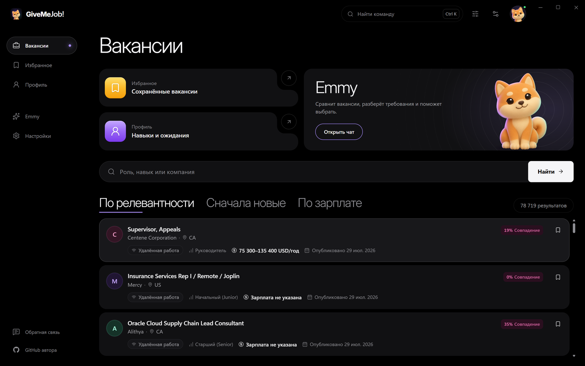
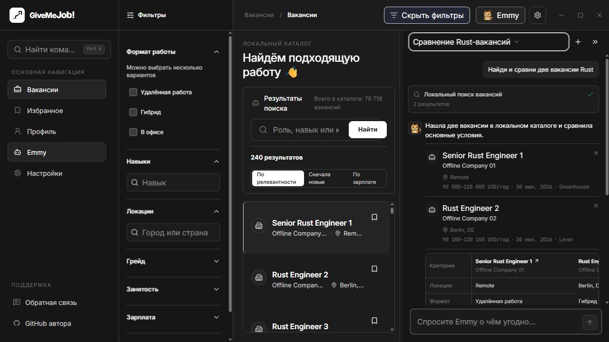
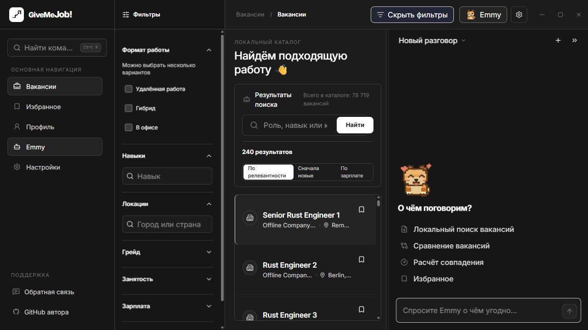
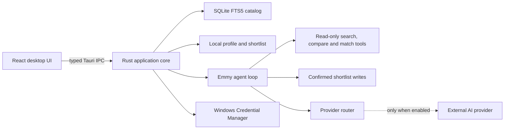

<p align="right">🌐 <strong>English</strong> · <a href="README.ru.md">Русский</a></p>

# GiveMeJob!

**Search 78,719 jobs entirely offline, get explainable matches, and ask Emmy to work with local career tools while your profile and shortlist stay on your PC.**



[](https://github.com/emmzde/GiveMeJob/actions/workflows/quality.yml)
[](https://github.com/emmzde/GiveMeJob/releases/latest)
[](LICENSE)
[](https://tauri.app/)
[](https://www.rust-lang.org/)

| Emmy compares jobs through local tools | Left-click Emmy to pet her |
| --- | --- |
|  |  |

## Why

I was tired of scrolling through nearly identical job boards and giving every new service the same personal data. GiveMeJob! is my attempt to make job search calmer and more inspectable: the catalog is local, matching explains itself, and AI is an optional assistant rather than the database.

## Key features

- **Real offline search.** SQLite FTS5 searches a frozen catalog of 78,719 vacancies without a hosted backend or an internet connection.
- **Emmy, a tool-using career assistant.** Emmy can search, compare, explain matches and propose shortlist changes through typed local tools; writes require confirmation.
- **Explainable matching.** Candidate-to-job scores are deterministic and break down skills, role, seniority, location and salary instead of hiding behind a black box.
- **Local-first privacy.** Profiles, saved jobs and search data stay on the device. Network access is used only for original vacancy links or an AI provider the user explicitly enables.
- **Resilient AI routing.** BYOK credentials live in Windows Credential Manager, with validation, provider fallback and a custom OpenAI-compatible endpoint.

## Tech stack

| Layer | Technology | Role |
| --- | --- | --- |
| Desktop shell | **Tauri 2** | Native Windows lifecycle, packaging and secure IPC |
| Core | **Rust** | Search commands, matching, persistence and Emmy orchestration |
| Interface | **React 19 + TypeScript 6** | Accessible, bilingual desktop UI |
| Local data | **SQLite + FTS5** | Frozen catalog, full-text search and user state |
| Tooling | **Vite, Vitest, Python 3.13** | Frontend builds, tests and deterministic catalog exports |

## Architecture



The React layer never reads the database directly. It calls a narrow Tauri command surface; Rust validates every request, runs local search or persistence, and returns typed payloads. Emmy uses the same local capabilities as tools, keeps mutations behind a confirmation step, and reaches the network only through the provider router.

## Quick start

### Install on Windows

1. Open the [latest GitHub Release](https://github.com/emmzde/GiveMeJob/releases/latest).
2. Download the NSIS installer or the portable ZIP.
3. Verify the download against `SHA256SUMS.txt`, then launch GiveMeJob!.

The v1.0.0 binaries are currently unsigned, so Windows SmartScreen may show a warning. Download builds only from this repository.

### Run from source

Requirements: Node.js 24+, pnpm 11.9, stable Rust, and Python 3.13 with [uv](https://docs.astral.sh/uv/).

```powershell
corepack enable
pnpm install --frozen-lockfile
uv sync --locked --all-groups
pnpm desktop:dev
```

The app needs no PostgreSQL server at runtime. PostgreSQL is used only by the developer-side catalog exporter; copy `.env.example` to `.env` only for exporter work and never commit it.

## Quality gates

```powershell
pnpm quality
```

The release gate aligns project metadata, type-checks and lints the UI, runs the frontend, Rust and Python suites, builds the production web layer, and treats Clippy warnings as errors. GitHub Actions repeats the same checks on `main` and pull requests.

## Repository map

| Path | Contents |
| --- | --- |
| `apps/desktop` | React frontend and Tauri/Rust desktop application |
| `config` | Search configuration and frozen-catalog manifest |
| `tools/catalog_export` | Deterministic PostgreSQL-to-SQLite export pipeline |
| `tests` | Exporter and contract tests |
| `docs` | Architecture notes, release process and verification evidence |

## Known limitations and roadmap

- [ ] Sign Windows binaries to remove the SmartScreen warning.
- [ ] Add in-app catalog updates; v1.0.0 ships a frozen July 2026 snapshot.
- [ ] Package macOS and Linux builds after the Windows workflow is stable.
- [ ] Expand end-to-end testing on clean Windows virtual machines.

## License

GiveMeJob! is released under the [MIT License](LICENSE).
