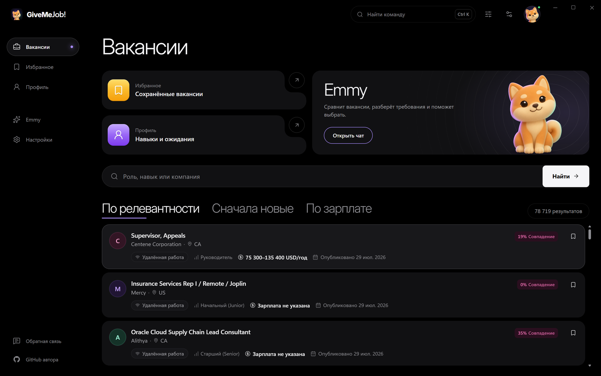
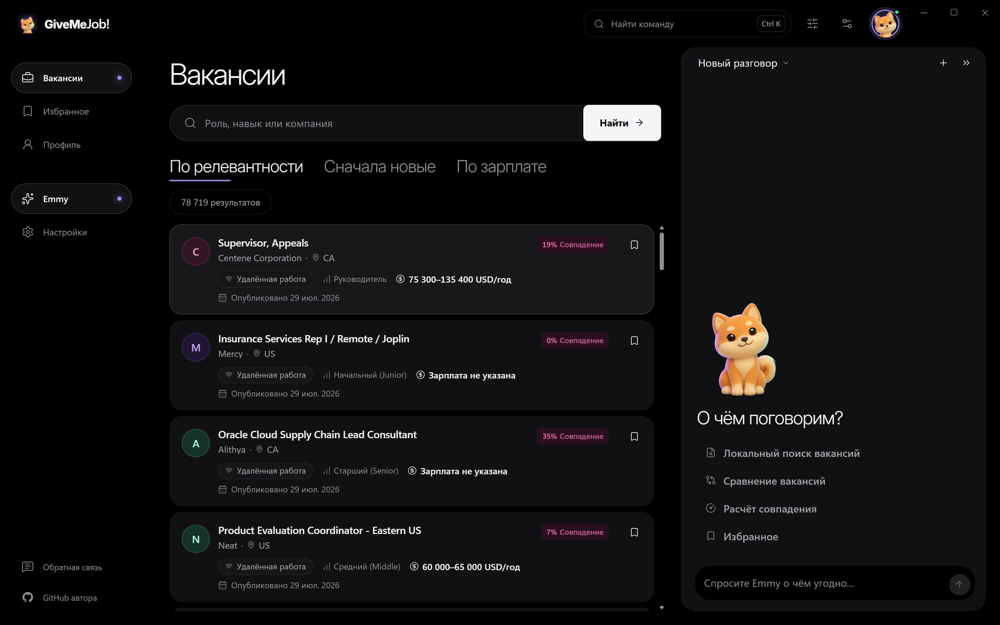
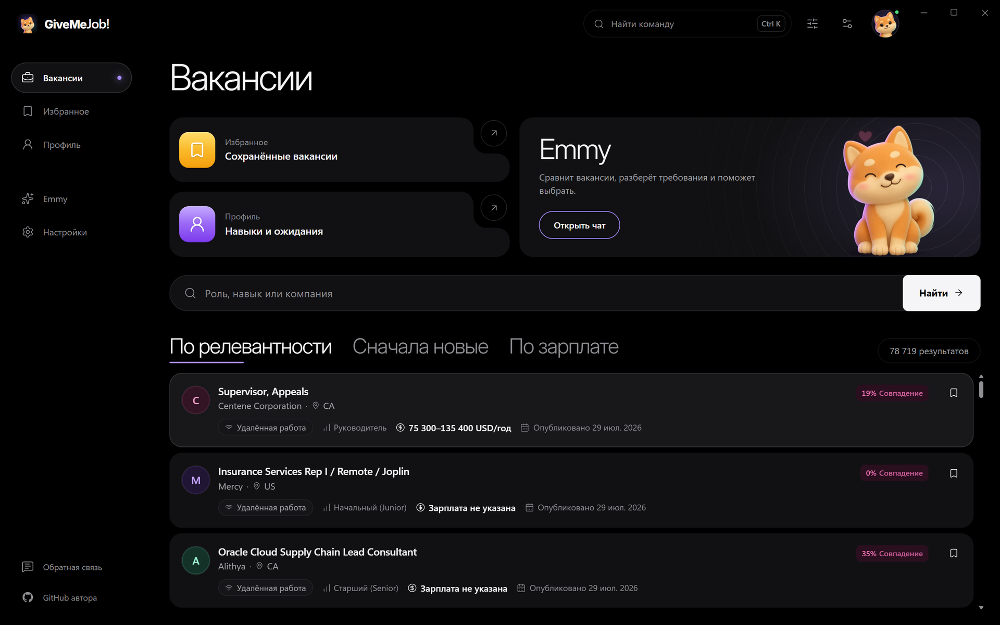
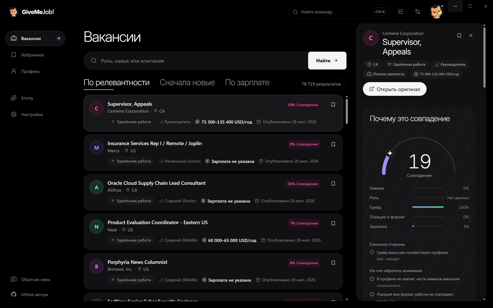
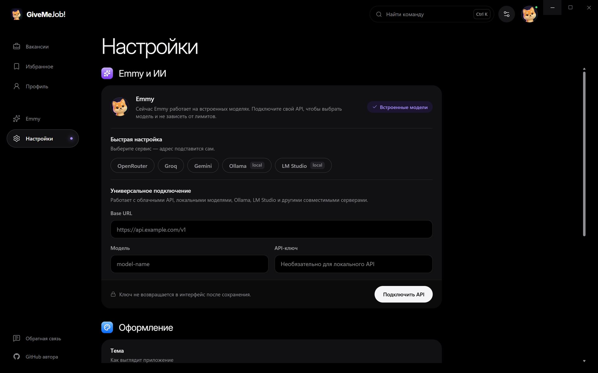
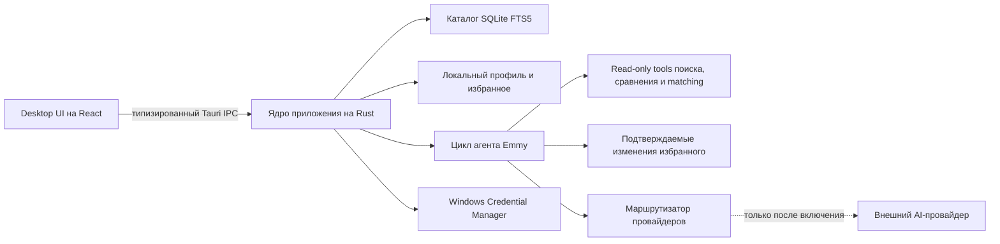

<p align="right">🌐 <a href="README.md">English</a> · <strong>Русский</strong></p>

# GiveMeJob!

**Ищите среди 78 719 вакансий полностью офлайн, получайте объяснимый процент совпадения и поручайте Emmy работу с локальными карьерными инструментами — профиль и избранное остаются на вашем компьютере.**



[](https://github.com/emmzde/GiveMeJob/actions/workflows/quality.yml)
[](https://github.com/emmzde/GiveMeJob/releases/latest)
[](LICENSE)
[](https://tauri.app/)
[](https://www.rust-lang.org/)

| Emmy, карьерный ассистент | Нажмите ЛКМ или проведите по Emmy, чтобы погладить |
| --- | --- |
|  |  |
| **Объяснимое совпадение** | **Настройки** |
|  |  |

## Зачем я это сделал

Мне надоело листать почти одинаковые джоб-борды и снова отдавать каждому сервису одни и те же личные данные. GiveMeJob! — моя попытка сделать поиск работы спокойнее и прозрачнее: каталог хранится локально, matching объясняет себя, а AI остаётся необязательным помощником, а не базой данных.

## Ключевые возможности

- **Настоящий офлайн-поиск.** SQLite FTS5 ищет по замороженному каталогу из 78 719 вакансий без удалённого backend и подключения к интернету.
- **Emmy — карьерный AI-агент с инструментами.** Emmy умеет искать, сравнивать и объяснять совпадения, а также предлагать изменения избранного через типизированные локальные tools; запись выполняется только после подтверждения.
- **Объяснимый matching.** Совпадение кандидата и вакансии рассчитывается детерминированно и раскладывается по навыкам, роли, грейду, локации и зарплате вместо непрозрачного «чёрного ящика».
- **Приватность по принципу local-first.** Профиль, сохранённые вакансии и данные поиска остаются на устройстве. Сеть используется только для открытия оригинала вакансии или обращения к AI-провайдеру, которого пользователь явно включил.
- **Отказоустойчивый AI-routing.** BYOK-ключи хранятся в Windows Credential Manager; предусмотрены валидация, переключение между провайдерами и собственный OpenAI-compatible endpoint.

## Технологии

| Слой | Технология | Задача |
| --- | --- | --- |
| Desktop shell | **Tauri 2** | Нативный жизненный цикл Windows, упаковка и безопасный IPC |
| Ядро | **Rust** | Поиск, matching, хранение данных и оркестрация Emmy |
| Интерфейс | **React 19 + TypeScript 6** | Доступный двуязычный desktop UI |
| Локальные данные | **SQLite + FTS5** | Замороженный каталог, полнотекстовый поиск и пользовательское состояние |
| Инструменты | **Vite, Vitest, Python 3.13** | Frontend-сборка, тесты и детерминированный экспорт каталога |

## Архитектура



React-слой никогда не читает базу напрямую. Он обращается к узкой поверхности Tauri-команд; Rust валидирует каждый запрос, выполняет локальный поиск или запись и возвращает типизированные данные. Emmy использует те же локальные возможности как tools, требует подтверждения для изменений и выходит в сеть только через маршрутизатор провайдеров.

## Быстрый старт

### Установка на Windows

1. Откройте [последний GitHub Release](https://github.com/emmzde/GiveMeJob/releases/latest).
2. Скачайте NSIS-установщик или portable ZIP.
3. Сверьте файл с `SHA256SUMS.txt`, затем запустите GiveMeJob!.

Бинарные файлы v1.0.0 пока не подписаны, поэтому Windows SmartScreen может показать предупреждение. Скачивайте сборки только из этого репозитория.

### Запуск из исходников

Понадобятся Node.js 24+, pnpm 11.9, стабильный Rust и Python 3.13 с [uv](https://docs.astral.sh/uv/).

```powershell
corepack enable
pnpm install --frozen-lockfile
uv sync --locked --all-groups
pnpm desktop:dev
```

Во время работы приложению не нужен PostgreSQL. Он используется только developer-инструментом экспорта каталога; копируйте `.env.example` в `.env` лишь для работы с exporter и никогда не добавляйте этот файл в Git.

## Проверки качества

```powershell
pnpm quality
```

Release gate синхронизирует метаданные проекта, проверяет типы и lint интерфейса, запускает frontend-, Rust- и Python-тесты, собирает production web layer и считает предупреждения Clippy ошибками. GitHub Actions повторяет те же проверки для `main` и pull request.

## Структура репозитория

| Путь | Содержимое |
| --- | --- |
| `apps/desktop` | React frontend и desktop-приложение на Tauri/Rust |
| `config` | Настройки поиска и manifest замороженного каталога |
| `tools/catalog_export` | Детерминированный pipeline экспорта PostgreSQL → SQLite |
| `tests` | Тесты exporter и контрактов |
| `docs` | Архитектурные заметки, процесс релиза и evidence проверок |

## Известные ограничения и roadmap

- [ ] Подписать Windows-бинарники, чтобы убрать предупреждение SmartScreen.
- [ ] Добавить обновление каталога внутри приложения; v1.0.0 содержит замороженный snapshot за июль 2026 года.
- [ ] Подготовить сборки для macOS и Linux после стабилизации Windows workflow.
- [ ] Расширить end-to-end тесты на чистых виртуальных машинах Windows.

## Лицензия

GiveMeJob! распространяется по условиям [MIT License](LICENSE).
