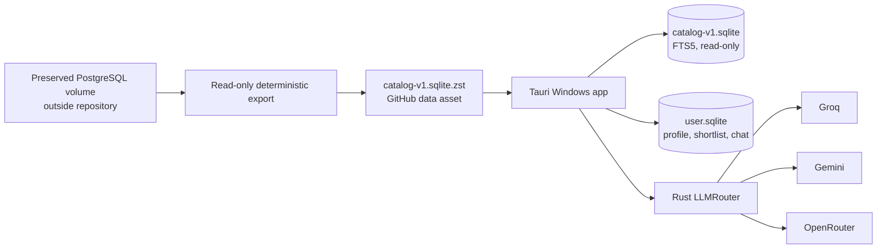

# GiveMeJob! — план автономного Windows pet MVP

Версия направления: 31 июля 2026 года.

Этот документ полностью заменяет прежний roadmap production-агрегатора и
описывает target architecture, а не автоматически достигнутый current state.
Единая иерархия документов:

1. `AGENTS.md` — rules;
2. `docs/DECISIONS.md` — ADR;
3. `docs/MVP_SCOPE.md` — scope;
4. этот файл — target plan;
5. `docs/METRICS.md` — metrics;
6. `docs/RELEASE_STATUS.md` — current status;
7. `docs/evidence/` — evidence конкретных проверок.

## 1. Продукт

GiveMeJob! — публичное Windows-приложение для поиска по замороженному каталогу
вакансий. Оно должно ощущаться как законченный продукт, а не как UI над
developer backend.

Ценность MVP:

- быстрый FTS-поиск по 78 719 вакансиям;
- понятные фильтры и клавиатурное управление;
- локальный профиль;
- честный match-score с объяснением;
- милая Emmy, которая умеет работать с тем же локальным каталогом;
- запуск без сервера и ручной настройки.

Видимая дата snapshot обязательна. Приложение не создаёт иллюзию live job
board.

## 2. Архитектура



Пользовательский runtime не содержит FastAPI, PostgreSQL, Redis, Celery,
Alembic или Python sidecar.

### 2.1 Catalog artifact

Однократный export:

1. Read-only запрос выбирает активные canonical jobs.
2. HTML/Markdown приводится к безопасному plain text.
3. Skills агрегируются в canonical English names и alias search text.
4. Записи вставляются в SQLite в стабильном порядке по ID.
5. Создаётся FTS5 external-content index.
6. Выполняются integrity, foreign-key, job/FTS count и metadata gates,
   `ANALYZE` и `VACUUM`.
7. База сжимается в `catalog-v1.sqlite.zst`.
8. Формируются строгий manifest, отдельные SQLite/archive SHA-256 и
   `catalog-v1.sqlite.zst.sha256`.

Snapshot не коммитится из-за размера. В Git хранится только manifest:

```json
{
  "manifest_version": 1,
  "catalog_version": "1",
  "schema_version": 1,
  "description_format": "plain_text",
  "source_frozen_at": "2026-07-29T20:30:03.846872Z",
  "exported_at": "2026-07-31T11:09:37.316686Z",
  "published_at": null,
  "canonical_jobs": 78719,
  "jobs_with_skills": 68881,
  "jobs_with_salary": 22467,
  "source_commit_sha": "b30162a21d1e473b61d037d10165d283798aa586",
  "logical_checksum": "895d38f383597e7ba8e2de60c7cab5c99a8ae32de6df7f51035a225a4ed5bb6b",
  "sqlite_file": "catalog-v1.sqlite",
  "sqlite_size_bytes": 1043488768,
  "sqlite_sha256": "e03b6b3e76be625c432268043cc241eb133e41566c3057dfdb610dbab92ab71e",
  "archive_file": "catalog-v1.sqlite.zst",
  "archive_size_bytes": 340085972,
  "archive_sha256": "f05e661bbe4bfecfe46e4cc947ddc7c0ae0b0a43c43876ad00e3996b68475671"
}
```

`source_frozen_at` описывает свежесть данных, `exported_at` — сборку artifact,
а `published_at` заполняется только при публикации и до неё равен `null`. UI
показывает `source_frozen_at`; остальные две даты являются provenance.

Manifest schema использует только `snake_case`, не допускает дополнительных
полей и не содержит release URL/locator. Locator относится к M5 release
descriptor. Artifact filenames являются только basename: absolute paths,
директории и `..` запрещены. `description_text` — детерминированный Unicode
plain text после удаления Markdown/HTML chrome, `script` и `style`.

Release workflow скачивает только точный asset и прерывается при несовпадении
checksum.

### 2.2 Первый запуск и обновление

Tauri bundle содержит compressed catalog по пути
`resources/<archive_file>`. На первом запуске окно и initialization UI
показываются до завершения blocking worker:

1. Взять install lock, удалить stale temp и проверить свободное место.
2. Проверить archive SHA-256, потоково распаковать в уникальный temp и выполнить
   `flush`/`sync`.
3. Проверить decompressed SHA-256, catalog/schema versions, required tables,
   job/FTS count, foreign keys и полный SQLite `integrity_check`.
4. Переименовать файл атомарно с `.previous` rollback и открыть catalog
   read-only.
5. Записать строгий sidecar seal: checksum, size, versions и file metadata.
6. Создать или мигрировать `user.sqlite` на отдельном этапе; catalog recovery
   никогда его не затрагивает.

Первичная распаковка может занимать дольше обычного запуска и показывает
прогресс с состоянием Emmy `searching`. После инициализации целевой startup
меньше 1,5 секунды.

При обычном старте fast validation сравнивает seal и file metadata без полного
hash 1 ГБ SQLite. Изменение size/mtime или отсутствие seal переводит lifecycle
в `verifying`; неуспешная проверка с доступным archive — в `recovering`.
Установка защищена межпроцессным file lock, удаляет stale install temp после
прерванного запуска и заранее проверяет свободное место с резервом. При
обновлении новый catalog ставится side-by-side. Старый удаляется только после
успешного открытия нового. Пользовательская база не заменяется.

Необязательная проверка обновления приложения запускается асинхронно после
старта. Timeout, отсутствие сети или ошибка updater endpoint не блокируют
распаковку, открытие каталога и первый локальный поиск.

### 2.3 Локальные интерфейсы

#### 2.3.1 Current M2 IPC

Ниже зафиксирован реализованный M2-контракт после reconciliation. SQLite
хранит `jobs.id` как `INTEGER`, но наружу ID сериализуется строкой:

```ts
const jobIdSchema = z.string().regex(/^[1-9]\d*$/).brand<"JobId">();
type JobId = z.infer<typeof jobIdSchema>;

interface SearchQuery {
  text: string;
  skills: string[];
  locations: string[];
  remoteModes: RemoteMode[];
  seniorities: Seniority[];
  employmentTypes: EmploymentType[];
  salaryMinUsdYear?: number;
  salaryKnownOnly: boolean;
  sources: string[];
  sort: "relevance" | "newest" | "salary";
  limit: number; // integer 1..50
  cursor?: SearchCursor; // opaque string, max 2048 chars
}

interface JobSummary {
  id: JobId;
  title: string;
  company: string;
  locationText: string;
  remoteMode: RemoteMode | null;
  seniority: Seniority | null;
  salaryMin: number | null;
  salaryMax: number | null;
  salaryCurrency: string | null;
  salaryPeriod: string | null;
  postedAt: string | null;
  source: string;
  attribution: string;
}

interface CatalogStatus {
  state: "initializing" | "verifying" | "ready" | "missing" | "recovering" | "error";
  stage: "starting" | "checking_seal" | "checking_space" |
    "checking_archive" | "decompressing" | "checking_catalog" |
    "checking_sqlite" | "activating" | "opening" | "cleaning_up" | null;
  progress: number; // monotonic 0..100 within one lifecycle run
  catalogVersion: string | null;
  sourceFrozenAt: string | null;
  totalJobs: number;
  message: string | null;
}

const searchCursorSchema = z.string().min(1).max(2048).brand<"SearchCursor">();
type SearchCursor = z.infer<typeof searchCursorSchema>;

interface SearchPage<T> {
  items: T[];
  nextCursor: SearchCursor | null;
  total?: number;
  suggestion?: string;
}

interface JobDetail extends JobSummary {
  description: string; // максимум 64 000 Unicode scalars
  skills: string[];
  employmentType: EmploymentType | null;
  salaryUsdYear: number | null;
  sourceUrl: string; // HTTPS в catalog-v1
  applyUrl: string | null;
  snapshotVersion: string;
}

interface SkillFacet { skill: string; count: number }
interface LocationFacet { location: string; count: number }
interface SourceFacet { source: string; count: number }

interface SearchFacets {
  skills: SkillFacet[];
  locations: LocationFacet[];
  sources: SourceFacet[];
}

interface FilterOptions {
  sources: SourceFacet[];
  remoteModes: ["remote", "hybrid", "onsite"];
  seniorities: [
    "intern", "junior", "middle", "senior", "lead", "staff",
    "principal", "manager", "director", "executive"
  ];
  employmentTypes: [
    "full_time", "contract", "part_time", "internship",
    "temporary", "volunteer", "other"
  ];
}

interface AutocompleteRequest { query: string; limit: number } // limit 1..20
interface SkillSuggestion {
  label: string;
  canonicalName: string;
  count: number;
}
interface LocationSuggestion {
  label: string;
  canonicalValue: string;
  kind: "country" | "city" | "location_text";
  count: number;
}

type IpcError =
  | { code: "catalog_missing" }
  | { code: "catalog_corrupt" }
  | { code: "catalog_busy" }
  | { code: "disk_full" }
  | { code: "invalid_query" }
  | { code: "not_found" }
  | { code: "open_failed" }
  | { code: "recovery_failed" }
  | { code: "internal" };
```

Все response object schemas используют zod `.strict()`. Общие Rust/TypeScript
fixtures находятся в `tests/contracts/m2_ipc_contracts.json`.

Реализованные операции:

```ts
invoke("catalog_status"): Promise<CatalogStatus>
invoke("recover_catalog"): Promise<CatalogStatus>
invoke("search_jobs", { request: query }): Promise<SearchPage<JobSummary>>
invoke("get_job", { id }): Promise<JobDetail>
invoke("open_original", { jobId }): Promise<void>
invoke("get_search_facets"): Promise<SearchFacets>
invoke("get_filter_options"): Promise<FilterOptions>
invoke("autocomplete_skills", { request }): Promise<SkillSuggestion[]>
invoke("autocomplete_locations", { request }): Promise<LocationSuggestion[]>
```

`get_filter_options` возвращает все source counts из frozen catalog и полный
закрытый enum-контракт, а не только значения, встретившиеся в конкретном
snapshot. Autocomplete выполняется только локально. Skill suggestion разделяет
пользовательский `label` и отправляемый canonical value: для `Python` это
`label = "Python"`, `canonicalName = "Python (computer programming)"`.
Location suggestion возвращает точное значение для существующей OR-семантики,
его основной kind и count уникальных jobs.

`get_job` проверяет branded decimal `JobId` до обращения к SQLite и возвращает
description только в detail payload. Catalog-v1 имеет `description_format =
"plain_text"`; frontend выводит description как обычный React-текст без HTML.
`open_original` принимает только `jobId`, заново читает `source_url` в Rust,
разрешает для текущего snapshot только HTTPS и передаёт ссылку системному
браузеру. Произвольный URL из frontend команда не принимает.

Команды отклоняются только закрытым `IpcError`; локальные path и сырые SQLite
errors в frontend не передаются.

#### 2.3.2 Future M3 contract

После завершения M2 текущий поиск расширяется, а не подменяется несуществующим
контрактом. M3 добавляет локальные user data и match:

```ts
type M3SearchQuery = Omit<SearchQuery, "sort"> & {
  savedOnly: boolean;
  sort: "relevance" | "match" | "newest" | "salary";
  cursor?: SearchCursor;
};

interface M3JobSummary extends JobSummary {
  match: number | null;
  saved: boolean;
}

saveProfile(input: ProfileInput): Promise<UserProfile>
getMatchBreakdown(id: JobId): Promise<MatchBreakdown>
setShortlist(id: JobId, saved: boolean): Promise<ShortlistState>
```

Emmy в M4 использует тот же `JobId` в `get_job`, `compare_jobs`,
`get_match_breakdown` и `set_shortlist`. Все payload валидируются;
произвольный SQL через IPC запрещён.

## 3. Offline search

### 3.1 Индексация

FTS5 поля и BM25 weights:

| Поле | Вес |
|---|---:|
| title | 8 |
| skills | 6 |
| company | 3 |
| location | 2 |
| description | 1 |
| search_aliases | 1 |

Дополнительное поле `search_aliases` содержит:

- canonical ESCO skill;
- русские и английские aliases;
- нормализованные варианты role/title;
- распространённые сокращения.

Tokenizer: `unicode61 remove_diacritics 2`, prefix indexes `2 3 4`.

### 3.2 Query pipeline

1. Backend NFKC normalization, lowercase для search lookup и единая свёртка
   Unicode whitespace.
2. Выделение фраз безопасным parser; незакрытая кавычка остаётся данными.
3. Canonicalization skills/roles по versioned alias maps. Filter arrays до
   fingerprint и SQL сортируются и dedupe после Unicode normalization.
4. Безопасная сборка FTS expression: `AND` между concepts, `OR` между aliases
   одного concept. Пользовательские `AND`, `OR`, `NEAR` и скобки всегда
   экранируются как данные, phrase grouping сохраняется.
5. BM25.
6. Детерминированный relevance tuple: exact normalized title сначала, затем
   количество exact canonical skills из `job_skills`, затем BM25.
7. Детерминированный sort и финальный tie-break по job ID.
8. При нулевой/слабой выдаче — spelling suggestion по небольшому словарю
   ролей и skills, без fuzzy scan всех вакансий. Формально слабая выдача — не
   более трёх результатов; suggestion не применяется автоматически.

`config/search/skill_aliases.json` и `role_aliases.json` имеют
`schema_version = 1` и проверяются Rust loader. Alias, принадлежащий нескольким
canonical entries, запрещён без явного `ambiguous_alias_targets`. Для
пунктуационно значимых skills сохраняются исходные формы `C++`, `C#`, `.NET` и
`Node.js`; Playwright не является alias Selenium.

### 3.3 Фильтры и пагинация

Фильтры выполняются параметризованным SQL. Значения внутри одной категории
объединяются через OR, активные категории — через AND.

Зарплатная семантика фиксирована:

- `salaryMinUsdYear` → `salary_usd_year >= salaryMinUsdYear`;
- `salaryKnownOnly` → `salary_usd_year IS NOT NULL`.

Location сохраняет прежнюю точную семантику без case folding: значения внутри
массива объединяются через OR сразу по `country`, `city` и `location_text`.
Перед обязательным exact predicate candidate IDs выбираются через
`jobs_location_idx` для country/city и column-scoped FTS5 для `location_text`.
Значения без FTS-токенов используют bounded exact fallback, поэтому punctuation
или emoji-only input не создаёт false negative. Salary threshold аналогично
использует `jobs_salary_idx` как preselector и затем повторяет exact predicate.

Для first-page location/salary query exact total и page вычисляются одним
проходом по минимальной materialized projection. FTS relevance остаётся на
отдельном exact-count пути, потому что SQLite `bm25()` нельзя переносить за
пределы разрешённого FTS ranking context.

Сортировки:

- `relevance` используется при непустом тексте;
- пустой `relevance` ведёт себя как `newest`;
- `salary` ставит известный `salary_usd_year` перед `NULL`;
- job ID является последним tie-break для любого sort.

Пагинация реализована как cursor/keyset по ranking tuple соответствующей
сортировки и `job_id`, limit не больше 50. Offset pagination не используется.
Запрос получает `limit + 1` строку, но возвращает в `items` не больше `limit`.
Opaque cursor v3 содержит catalog version, fingerprint нормализованного
query/filter/sort и позицию с `JobId` как decimal string. Relevance cursor
продолжается по final ranking tuple, `posted_at` и ID; BM25 кодируется как
бит-точный hex IEEE 754. `newest` явно ставит `posted_at IS NULL` после
известных дат, `salary` — неизвестные зарплаты после известных. Cursor другого
query, filter, sort, catalog или envelope version отклоняется как
`invalid_query`.

Exact total вычисляется только для первой страницы. Контракт оставляет поле
optional; следующие страницы не повторяют count, а UI при отсутствующем total
показывает количество загруженных jobs. Решение подтверждено замером
[`evidence/M2_EXACT_COUNT_2026-07-31.md`](evidence/M2_EXACT_COUNT_2026-07-31.md).

Лента виртуализирована. Менять sort/filter можно без блокирующей модалки;
предыдущие результаты остаются до готовности новых.

В текущем M2 UI сортировка существует только в toolbar выдачи и не
дублируется chip-ом. «Сбросить все» очищает фильтры, но сохраняет search text и
выбранную сортировку. Следующая cursor page загружается явно и добавляется к
ленте; после 50 загруженных вакансий используется TanStack Virtual.

### 3.4 Производительность

- warm search p95: целевой уровень строго <150 мс;
- hard gate warm search p95: строго <300 мс;
- cold first query: <500 мс после завершённой распаковки;
- scroll: 60 fps;
- steady-state RAM: <250 МБ.

Методика измерения зафиксирована в `docs/METRICS.md`.
Текущий filter/location/salary corpus benchmark зафиксирован в
[`evidence/M2_FILTERS_SQL_PERFORMANCE_2026-07-31.md`](evidence/M2_FILTERS_SQL_PERFORMANCE_2026-07-31.md):
worst clean release p95 `273.02 ms`, новые indexes не потребовались.

## 4. Профиль, shortlist и match

### 4.1 Онбординг

Анкета:

- до пяти желаемых ролей;
- seniority;
- skills через autocomplete;
- страна/город;
- допустимые remote modes;
- минимальная желаемая годовая зарплата USD, опционально.

Онбординг можно пропустить. Без профиля поиск и shortlist работают, а
match-sort скрыт.

### 4.2 Match formula

| Компонент | Вес | Правило |
|---|---:|---|
| skills | 40% | доля canonical job skills, присутствующих в профиле |
| role | 20% | exact/alias/token overlap желаемой роли и title |
| seniority | 15% | детерминированная compatibility matrix |
| location/work mode | 15% | remote или совпадение выбранной географии/режима |
| salary | 10% | overlap диапазона с minimum expectation |

Если данные вакансии для компонента отсутствуют, вес распределяется
пропорционально между известными компонентами.

```ts
interface MatchBreakdown {
  score: number;
  components: {
    skills?: number;
    role?: number;
    seniority?: number;
    location?: number;
    salary?: number;
  };
  strengths: MatchReason[];
  gaps: MatchReason[];
}
```

Score всегда воспроизводим. Он не меняется из-за провайдера, сети или истории
чата. UI подписывает его как «Совпадение», не «вероятность».

### 4.3 Пользовательская база

`user.sqlite` хранит:

- единственный локальный профиль;
- shortlist;
- recent searches;
- настройки;
- conversation metadata/messages;
- provider health и локальные quota counters.

При удалении приложения пользователь может выбрать удаление local data.
Экспорт/синхронизация профиля не входит в v1.

## 5. UI и Emmy

### 5.1 Layout

Три основные колонки:

1. navigation + filters;
2. virtualized feed;
3. job detail.

Emmy открывается дополнительной панелью поверх правой части. При узкой ширине
job detail и Emmy становятся mutually exclusive panels.

Реализованный M2 shell позволяет независимо скрыть filters и job detail;
на узком окне они становятся overlay panels. Выбранная вакансия имеет
`aria-current`, акцентный фон и левую границу. В feed используются monogram
компании, стабильные колонки location/salary и явное состояние неизвестной
зарплаты. Description остаётся недоверенным plain text, но безопасно
разбивается React-компонентом на абзацы, маркированные списки и NOTE-блок без
HTML/Markdown rendering.

Экраны:

- короткий onboarding;
- feed/search;
- job detail;
- shortlist;
- profile/settings;
- Emmy chat;
- first-run catalog initialization;
- update/error/offline states.

Хоткеи:

- `/` — focus search;
- `j/k` — selection;
- `s` — shortlist;
- `Ctrl+Enter` — original URL;
- `Ctrl+K` — command palette;
- `Ctrl+E` — Emmy.

### 5.2 Маскот

Emmy — code-native layered SVG, а не растровая картинка.

```ts
type EmmyState =
  | "idle"
  | "listening"
  | "thinking"
  | "searching"
  | "success"
  | "empty"
  | "error"
  | "offline";
```

Анимация использует transform/opacity и не вызывает layout thrashing.
`prefers-reduced-motion` обязателен. Цвета берутся только из design tokens.

### 5.3 Agent tools

```ts
type EmmyToolCall =
  | { name: "search_jobs"; args: SearchQuery }
  | { name: "get_job"; args: { jobId: string } }
  | { name: "compare_jobs"; args: { jobIds: string[] } }
  | { name: "get_match_breakdown"; args: { jobId: string } }
  | { name: "set_shortlist"; args: { jobId: string; saved: boolean } };

interface EmmyResponse {
  message: string;
  jobCards: string[];
  quickReplies: string[];
  mascotState: EmmyState;
  toolCall?: EmmyToolCall;
}
```

`compare_jobs` принимает 2–4 ID. `set_shortlist` сначала возвращает preview,
затем исполняется после явного подтверждения.

Agent loop ограничен четырьмя tool steps. Job descriptions оборачиваются как
untrusted tool data. Модель не получает произвольный filesystem/network tool.

## 6. LLMRouter и demo credentials

### 6.1 Провайдеры

Начальный capability pool:

- Groq `llama-3.1-8b-instant` — простой чат;
- Groq `qwen/qwen3.6-27b` — tools, русский язык, сравнения;
- Gemini `gemini-3.5-flash-lite` — provider fallback;
- OpenRouter `openrouter/free` — emergency fallback.

Текущие лимиты перепроверяются перед release:

- [Groq rate limits](https://console.groq.com/docs/rate-limits);
- [Groq Qwen 3.6 27B](https://console.groq.com/docs/model/qwen/qwen3.6-27b);
- [Gemini pricing](https://ai.google.dev/gemini-api/docs/pricing);
- [OpenRouter pricing](https://openrouter.ai/pricing).

### 6.2 Routing

Для каждого provider/model локально хранятся:

- EWMA latency;
- success/error counts;
- последнее 429;
- cooldown until;
- оценка локально использованной квоты.

Router:

1. Фильтрует модели по required capabilities.
2. Исключает cooldown/quota-exhausted.
3. Выбирает лучший health score.
4. Вызывает с timeout.
5. Валидирует structured output.
6. На rate limit, timeout, transport или schema error пробует следующую.
7. При полном отказе возвращает typed `Unavailable`.

Параллельно модели не вызываются.

### 6.3 Privacy

Провайдеру отправляются:

- system prompt;
- максимум 12 последних сообщений;
- текущий запрос;
- минимальный tool result.

Не отправляются:

- вся база;
- сырой профиль;
- resume;
- local settings;
- BYOK другого провайдера;
- произвольные файлы.

### 6.4 Встроенные ключи

Build pipeline:

1. PR CI использует fake adapters.
2. Release environment содержит provider keys в GitHub Secrets.
3. Secrets передаются Rust build process без печати.
4. Rust compile-time фрагментирует/обфусцирует значения.
5. Provider HTTP вызывается только из Rust.
6. Ключ не возвращается через IPC.
7. Временный буфер очищается после запроса.

Это не делает ключ секретным от владельца компьютера. Каждый demo key:

- отдельный от личных аккаунтов;
- free-tier;
- без billing;
- с минимальными scopes;
- с жёсткими provider quotas;
- пригоден для немедленного revoke.

Signed remote config может изменить priority/disable provider, но не может
отозвать украденный ключ: отзыв выполняется в кабинете провайдера.

BYOK хранится в Windows Credential Manager и имеет приоритет.

## 7. Release

### 7.1 CI

Обязательные jobs:

- Python data tooling: Ruff, format check, mypy, pytest;
- frontend: typecheck, ESLint, Vitest, web build;
- Rust: fmt, clippy, tests;
- snapshot contract;
- Windows Tauri build;
- secret scan.

PR workflows не имеют release secrets.

### 7.2 Artifacts

Pre-stable flow:

1. приватный RC artifact из CI без GitHub Release;
2. smoke test на чистой Windows 10 и Windows 11;
3. исправления и новый приватный RC;
4. первый публичный release — stable `v0.1.0`.

Публичного preview/prerelease текущий ADR не разрешает. Для него нужен
отдельный ADR до создания тега или GitHub Release.

Каждый release:

- NSIS installer;
- portable ZIP;
- SHA-256 checksums;
- updater manifest/signatures;
- `NOTICE_DATA.md`;
- snapshot version и known limitations.

Updater private key хранится только в GitHub Secrets. Public key находится в
Tauri config. Portable build уведомляет о новой версии и допускает ручное
скачивание.

Authenticode отсутствует в v1; SmartScreen warning документируется.

## 8. Этапы реализации

Состояние публикации и gate первого `v0.1.0` зафиксированы в
[`RELEASE_STATUS.md`](RELEASE_STATUS.md).

### D0. Документационный pivot

- [x] Windows-only pet-project scope.
- [x] Offline SQLite architecture.
- [x] Frozen dataset.
- [x] Match и Emmy contracts.
- [x] Release/demo-key policy.
- [x] Legacy API/ingestion удалён после snapshot gate.

Критерий: все документы описывают одно направление.

### M1. Snapshot

- [x] Read-only SQL подтверждение исходного среза.
- [x] Детерминированный export.
- [x] SQLite schema/FTS build.
- [x] Integrity, attribution, URL, row count.
- [x] Compression, manifest, SHA-256.
- [x] Versioned release artifact подготовлен локально.
- [x] Export contract и реальный integration run.

Критерий: artifact содержит 78 719 jobs и воспроизводим из frozen PostgreSQL.

### M2. Offline search и shell

- [x] First-run unpack.
- [x] Catalog versioning.
- [x] Search repository.
- [x] Backend filters.
- [x] Backend sorts: relevance, newest, salary.
- [x] Cursor/keyset pagination.
- [x] Search correctness: Unicode/phrases/aliases/ranking/typo golden fixtures.
- [x] Three-column UI shell.
- [x] Filter/sort UI wiring и exact IPC payload tests.
- [x] Cursor pagination и virtualized feed после 50 загруженных jobs.
- [x] Job detail и original link.
- [x] System/light/dark session theme, AA text/placeholder tokens и responsive panels.
- [x] `/`, roving `j/k`, virtual scroll и `Ctrl+Enter`; editable controls не перехватываются.
- [x] `cmdk` palette с доступным dialog, focus trap/restore и только M2 actions.
- [x] Axe smoke для shell, filters, feed, detail, errors и command dialog.
- [x] Catalog/search/detail loading, empty и error states.
- [x] Versioned 90-query release benchmark, cold IPC query, full cursor audit,
  feed scroll, repeated startup, steady-state RAM, corrupt recovery и реальные
  NSIS/portable first runs.
- [x] Полностью изолированная сеть и финальный native
  screen-reader/reduced-motion audit.

Критерий: поиск без сети; hard gate warm p95 строго <300 мс. Значение строго
<150 мс остаётся целевым уровнем.

Закрывающая запись:
[`evidence/M2_FINAL_ACCEPTANCE_2026-08-01.md`](evidence/M2_FINAL_ACCEPTANCE_2026-08-01.md).
Все hard gates, включая физически отключённое Wi-Fi radio, offline search/detail,
native Narrator/keyboard smoke и reduced motion, пройдены. M2 завершён;
текущий этап — M3.

### M3. Profile, match и shortlist

- [ ] Onboarding.
- [ ] `user.sqlite`.
- [ ] Match components.
- [ ] Match explanations.
- [ ] Shortlist persistence.
- [ ] Match sorting.

Критерий: весь этап работает при физически отключённой сети.

### M4. Emmy

- [ ] Layered SVG и state machine.
- [ ] Rust provider adapters.
- [ ] LLMRouter health/failover.
- [ ] Structured schemas.
- [ ] Пять tools.
- [ ] Confirmation flow.
- [ ] Built-in demo credentials.
- [ ] BYOK Credential Manager.
- [ ] Offline degradation.

Критерий: последовательный отказ провайдеров проверен тестом; local features
не деградируют.

### M5. Public Windows release

- [ ] Public repository.
- [ ] Secret/history audit.
- [ ] Windows release workflow.
- [ ] Tauri updater signing.
- [ ] Installer и portable.
- [ ] Clean-machine smoke.
- [ ] Private RC artifact.
- [ ] Stable v0.1.0.

Критерий: пользователь без dev-зависимостей устанавливает приложение, ищет,
создаёт профиль и общается с Emmy.

## 9. Тестовый план

### Data

- stable row order и checksum;
- ровно 78 719 canonical jobs;
- attribution/source_url not empty;
- FTS row count совпадает с jobs;
- `PRAGMA integrity_check = ok`;
- повторный export даёт тот же logical manifest.

### Search

- русский и английский запрос;
- canonical skill alias;
- quoted phrase;
- typo suggestion;
- каждый фильтр отдельно и в комбинации;
- cursor без пропусков/дублей;
- пустая выдача;
- invalid query не превращается в SQL.

### Match

- полный skill overlap;
- частичный overlap;
- unknown salary;
- incompatible seniority;
- remote/location conflict;
- одинаковый input — одинаковый JSON result;
- score всегда 0–100.

### UI

- keyboard-only;
- reduced motion;
- light/dark;
- first-run progress;
- no-network startup;
- broken source URL;
- catalog corruption recovery;
- сохранность user data после catalog update.

### Emmy

- valid response;
- tool call;
- malformed JSON;
- prompt injection в description;
- timeout;
- 429/Retry-After;
- provider fallback;
- all providers unavailable;
- max tool loop;
- shortlist confirmation;
- built-in key не появляется в JS/logs;
- BYOK precedence.

### Release

- Windows 10/11 x64;
- installer install/uninstall;
- portable launch;
- updater signature rejection;
- checksum;
- clean machine без Node/Rust/Python/Docker.

## 10. Риски

| Риск | Мера |
|---|---|
| Snapshot устаревает | Видимая дата и original link; не обещать live data |
| Source URL умер | Понятное состояние и сохранённая локальная карточка |
| Полный snapshot вызывает претензии | Attribution, NOTICE_DATA, возможность снять artifact |
| Catalog слишком большой | Только canonical normalized data, zstd, без raw/embeddings |
| Demo key извлечён | No billing, scopes/quotas, revoke, release rotation, BYOK |
| Бесплатная квота закончилась | Health routing, cooldown, BYOK, graceful offline |
| Model нарушила schema | Validation и fallback |
| Prompt injection | Untrusted data boundary и закрытый tool union |
| SmartScreen warning | Честная инструкция; Authenticode позже отдельным ADR |
| Scope снова растёт | Этапы и запрет соседних функций без нового решения |

## 11. Definition of Done

MVP готов, когда:

- public release устанавливается на чистую Windows;
- catalog проверяется и открывается;
- offline search проходит performance gate;
- профиль, shortlist и история переживают перезапуск;
- match-score объясним и воспроизводим;
- Emmy отображает корректное состояние, вызывает только разрешённые tools и
  переключает провайдеры;
- полный отказ AI не влияет на поиск;
- update artifact проверяется подписью;
- документация соответствует фактическому поведению.
